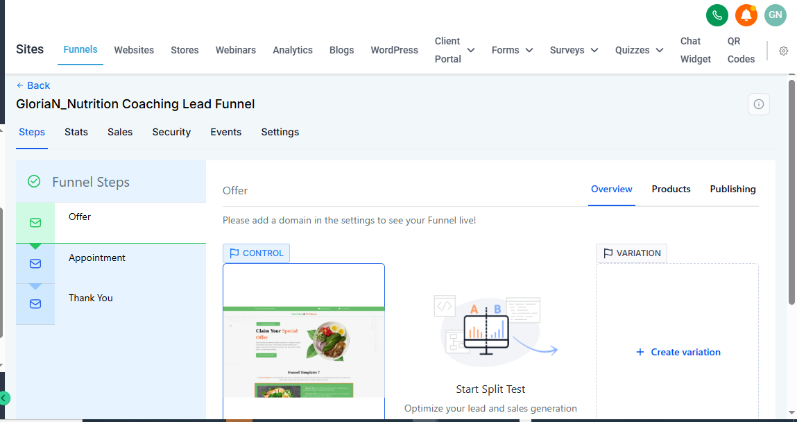
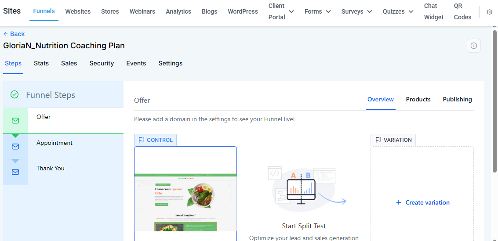
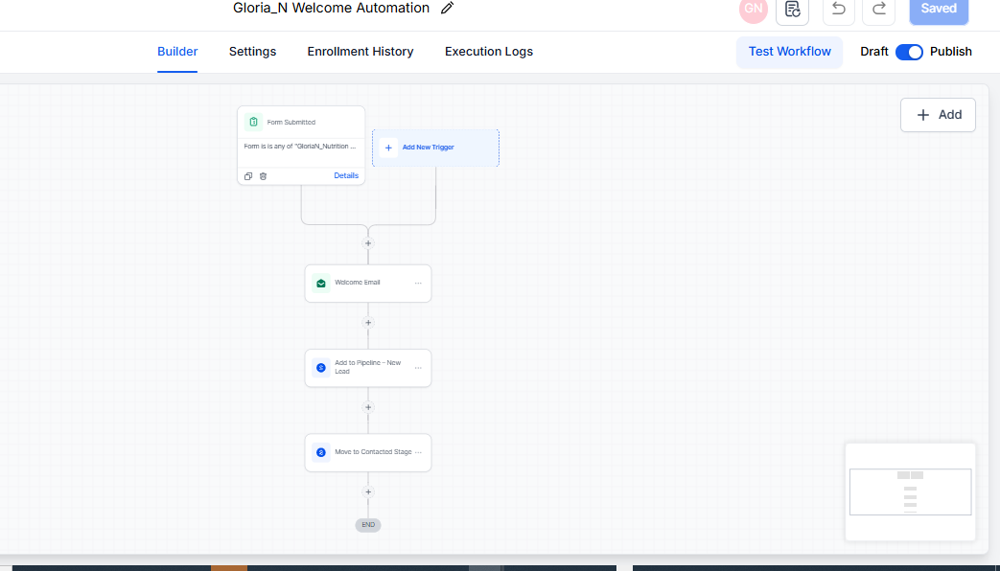
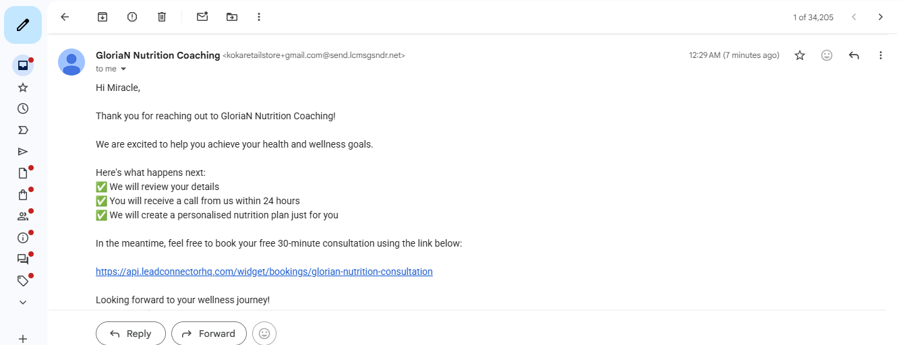
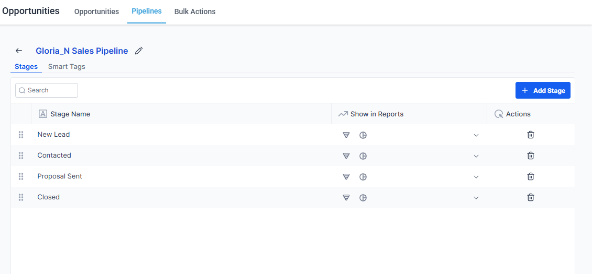
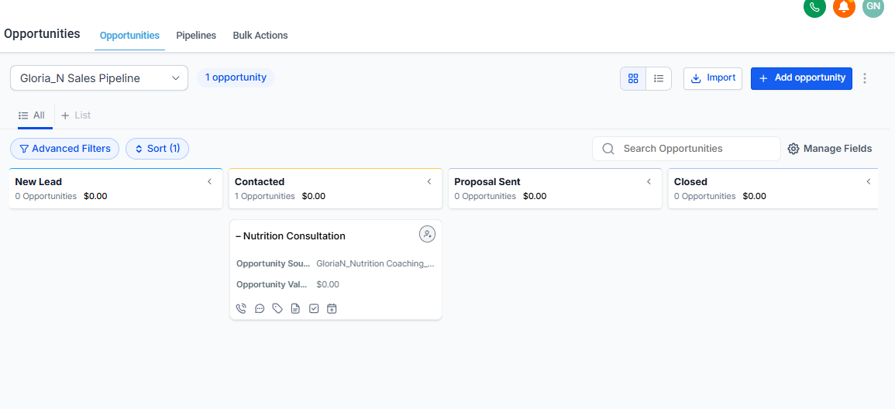
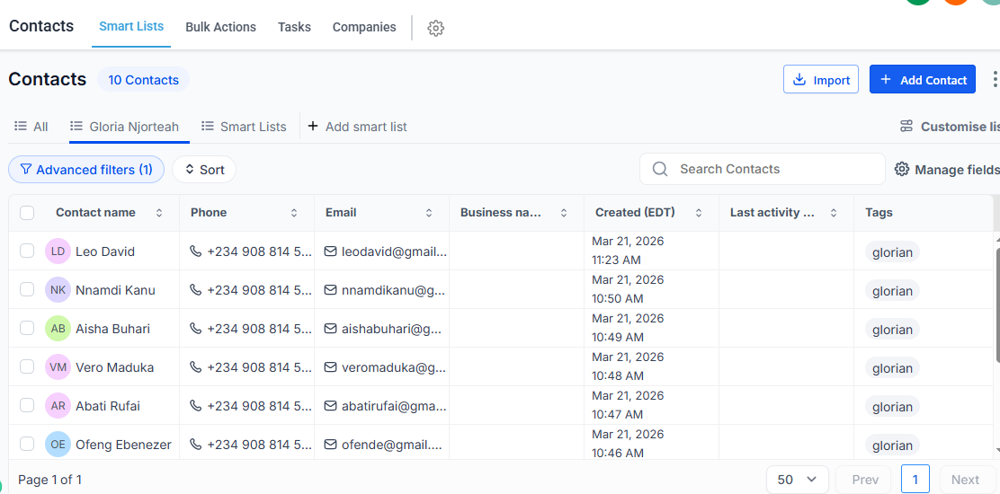
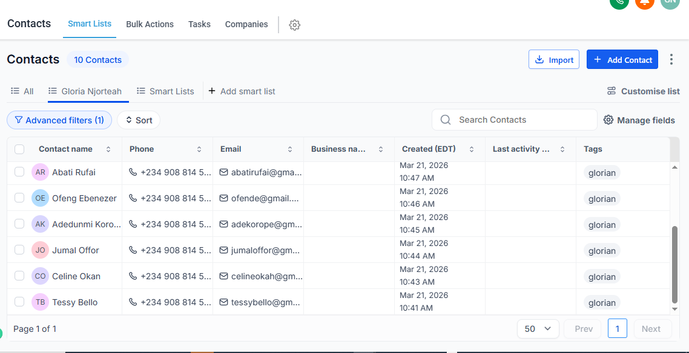

# GoHighLevel CRM Pipeline & Automation

Documentation and screenshots of a nutrition coaching lead funnel, CRM pipeline, and follow-up workflow.

## Funnel structure

| Step | Purpose |
|---|---|
| Offer page | Present the coaching offer and capture contact details |
| Appointment page | Offer a consultation booking calendar |
| Thank-you page | Confirm submission and explain next steps |

## CRM and automation

- Contact organization with tags and Smart Lists.
- Custom fields for fitness goal, budget, and lead source.
- Four pipeline stages: New Lead, Contacted, Proposal Sent, and Closed.
- Form submission followed by a welcome email, opportunity creation, and movement to Contacted.

## Screenshots

### Lead funnel

### Funnel pages

### Automation workflow

### Welcome email

### Pipeline stages

### Pipeline movement

### Contact lists

## Repository scope

This repository contains documentation and reference screenshots. It does not contain runnable website code, an importable GHL snapshot, or a deployed funnel. Names and account labels visible in the screenshots are part of the captured reference material. No new GHL build or live verification is represented by this repository upload.